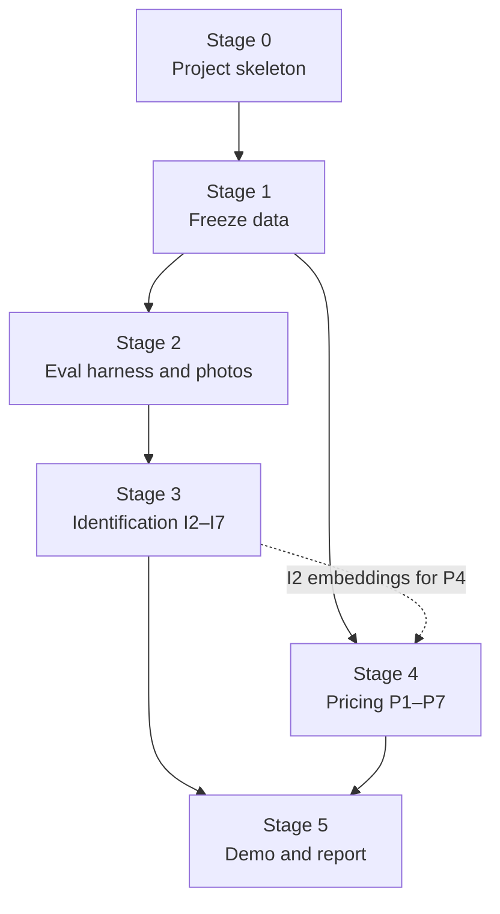

# Historical Step-by-Step Guide

> **Superseded on 2026-11-06 by [the revised plan](PLAN.md).** The current project uses free online data, allows manual annotation of public images, and starts with same-snapshot hidden-price estimation. Follow `PLAN.md` where these documents differ.

This earlier guide is retained for context. Its requirements to buy cards, take personal photos, and use optional paid sources are outside the agreed scope. Its detailed measurement claims are historical notes; their supporting scripts and result artifacts are not present in this repository and were not reproduced in the plan review. See `PLAN.md` for the checks actually performed and their limits.

Commands for `cardid.*` modules below describe an earlier proposed interface; those modules do not exist yet.

## 1. What the checks changed

| Finding | Evidence | Change to the plan |
| --- | --- | --- |
| The Pokémon TCG API goes offline on March 1, 2027, and the bulk repo is legacy | Deprecation notice in the [bulk repo README](https://github.com/PokemonTCG/pokemon-tcg-data) | Freeze the catalog and images this week |
| The API can't feed the price collector | All 4 sampled 2026 sets had no prices. Older sets: TCGplayer last updated 2026-10-15, Cardmarket between Nov 2025 and Jul 2026. 32 of 51 requests failed (no API key, 1 request per second or slower) | Replace P0's data source |
| Free TCGplayer history already exists | [TCGCSV](https://tcgcsv.com/docs) publishes daily archives from 2024-02-08. All 18 dates I sampled across that range exist, but I didn't check every day | Backfill it. P7 can start without waiting, and P2 can test cold starts at the correct point in time |
| TCGCSV joins to the catalog | 95.1% of 20,635 cards matched automatically, before hand-mapping 16 sets, and 19,591 of those 19,632 had a market price on 2026-11-05. Against TCGplayer's product links on a 60-card sample: 47 correct, 0 wrong, 3 unmatched, 10 with no link | Build a crosswalk table in Stage 1 |
| The catalog has one image per card, but prices are per printing | On 2026-11-05, 65% of matched priced products had more than one printing. The highest printing's price was a median 2.4× the lowest, and 11.6× at the 90th percentile | Identify the card, then price each printing separately (see E1) |
| The repo is public and `data/` is not gitignored | `git check-ignore` reports `data/`, `*.parquet`, and checkpoints as trackable, although the README says otherwise | Fix before the first download |
| One eval set would both tune and report results | I7 picks thresholds on the same photos it reports on | Split photos into dev and test |
| 300 photos are too few to split | At 85–95% accuracy, a 150-photo test set gives a 95% interval of ±3.5–5.7 points, even if every photo were independent. At 300 photos it's ±2.5–4.0 | Aim for 600 photos, split 300/300 |
| No photos test cards outside the catalog | English-only catalog, while real users will show Japanese or non-Pokémon cards | Add an out-of-catalog set |
| OCR can't be a hard constraint | It read 75 of 80 collector numbers on clean catalog images, so real photos will be worse | Use OCR as evidence in a score, not a filter |
| E3 can't be met as written | Its check is reproducing a headline number, but the photos aren't published | Publish predictions, and reproduce pricing from public data |

## 2. Decisions for you

1. **Physical cards.** Stage 2 needs about 250 cards, including about 50 same-art pairs from different sets. If you don't own them, buy a bulk lot and use the Stage 1 data to list the cheapest pairs. This is the only step that can't be automated.
2. **Where the daily collector runs.** A GPU instance is a poor host if you ever shut it down. The default below is a scheduled GitHub Action that pushes to a private data repo. If this machine stays on, plain cron is simpler.
3. **Whether to collect Cardmarket.** It's one 15.8 MB file a day and has no archive, so missed days are lost. I couldn't confirm its terms, so read them before starting. The default is to collect it if the terms allow. Everything except the two-marketplace comparison in P1 still works without it.

## 3. Order and effort



Pricing needs no photos, so Stages 3 and 4 can run in parallel. Effort figures are my rough estimates of focused working days, not measurements.

| Stage | Contents | Days | Deadline |
| --- | --- | --- | --- |
| 0 | Skeleton | 0.5 | Before any download |
| 1 | Catalog, images, price history, crosswalk, collector | 2 | This week; hard limit March 1, 2027 |
| 2 | Metrics, photos, labels, corners | 2–3 | None |
| 3 | I2–I7 | 14 | None |
| 4 | P1–P7 | 11 | None |
| 5 | E1–E4 | 5–6 | None |
| | **Total** | **about 35** | |

**First week:** finish Stage 0, then steps 1.1, 1.2, 1.5, and 1.7. Those protect data that may disappear. Order the cards if you need them.

---

## Stage 0: Project skeleton

- [ ] **0.1 Fix `.gitignore` first.** Append:

  ```gitignore
  # Data and artifacts: the repo is public, and images and raw prices stay out of it
  /data/
  /runs/
  /results/galleries/
  *.parquet
  !results/predictions/*.parquet
  *.7z
  *.pt
  *.ckpt
  *.safetensors
  *.onnx
  ```

  Check: `git check-ignore data/x.png runs/a.pt` prints both paths.

- [ ] **0.2 Create the environment.** This config was tested here: `uv lock` and `uv sync` succeed, and torch 2.15.0+cu132 sees the GPU (GH200, ARM64, driver 580.105.08). The ML and data packages import. `onnxruntime` offers CPU only, which is enough for OCR.

  ```toml
  [project]
  name = "cardid"
  version = "0.1.0"
  requires-python = ">=3.12,<3.13"
  dependencies = [
    "torch==2.15.*", "torchvision",
    "timm", "transformers", "kornia", "opencv-python-headless", "albumentations",
    "polars", "duckdb", "pyarrow", "py7zr", "httpx", "tenacity", "imagehash", "pillow",
    "faiss-cpu", "hnswlib", "lightgbm", "scikit-learn", "shap",
    "rapidocr-onnxruntime", "pytest", "ruff", "nbstripout", "jupyterlab", "gradio",
  ]

  [tool.uv]
  environments = ["sys_platform == 'linux' and platform_machine == 'aarch64'"]

  [tool.uv.sources]
  torch = { index = "pytorch-cu132" }
  torchvision = { index = "pytorch-cu132" }

  [[tool.uv.index]]
  name = "pytorch-cu132"
  url = "https://download.pytorch.org/whl/cu132"
  explicit = true

  [build-system]
  requires = ["hatchling"]
  build-backend = "hatchling.build"

  [tool.hatch.build.targets.wheel]
  packages = ["src/cardid"]
  ```

  Keep the environment on local disk, because NFS was about 6× slower for small-file writes here and the environment can be rebuilt from `uv.lock`:

  ```bash
  export UV_PROJECT_ENVIRONMENT=/home/ubuntu/.venvs/card-id-pricing   # also add to ~/.bashrc
  uv sync
  uv run python -c "import torch; print(torch.cuda.is_available())"
  ```

- [ ] **0.3 Create the layout.** It keeps the subfolders from `PLAN.md`, nested in one importable package, and adds `eval/`.

  ```
  card-id-pricing/
    README.md  PLAN.md  GUIDE.md  LEARNING_LOG.md  DATA_SOURCES.md
    pyproject.toml  uv.lock  Makefile
    configs/                  # one YAML per experiment
    src/cardid/
      paths.py                # the only file that knows where data lives
      results.py              # appends to results/results.csv
      catalog/  rectify/  synth/  embed/  rerank/
      prices/  pricing/  app/
      eval/                   # metrics shared by every milestone
    tests/
    notebooks/                # analysis only, outputs stripped
    results/results.csv
    results/predictions/      # ids and scores, no images
    runs/                     # gitignored; checkpoints and logs
    data/                     # gitignored
      raw/pokemon-tcg-data/   # clone pinned to one commit
      raw/tcgcsv/archive/     # never downloaded twice
      catalog/                # catalog.parquet, images/, lookalikes.parquet, crosswalk.parquet
      prices/tcgplayer/date=YYYY-MM-DD/
      prices/cardmarket/date=YYYY-MM-DD/
      eval_real_v1/           # photos/, ood/, manifest.csv, corners.csv, split.csv, SHA256SUMS
      backgrounds/
  ```

  `data/` sits on persistent NFS. Copy images to local disk (`/home/ubuntu/cache/`) for training, and assume that copy can disappear with the instance.

- [ ] **0.4 Fix the shared formats.**
  - `results/results.csv`: `date, git_hash, milestone, experiment, config, split, n, metrics_json, notes`.
  - Prediction files: `photo_id, stage, rank, card_id, score`. Every experiment writes one, so metrics can be recomputed without rerunning models.

- [ ] **0.5 Add guardrails.**
  - Run `nbstripout --install`. Notebook outputs would otherwise commit card images to a public repo.
  - Add `.github/workflows/ci.yml` to run `ruff` and `pytest` on CPU.
  - Create `LEARNING_LOG.md` and an empty `results/results.csv`, which the README already links to.

- [ ] **0.6 Update the docs.** Change the README's setup to `uv sync`, and update its data table and the `PLAN.md` datasets table to match Stage 1.

**Done when** a fresh `uv sync` works, `pytest` runs in CI, and `data/` can't be committed.

---

## Stage 1: Freeze the data

Do this before anything else. The API's hosts may disappear, and everything later depends on these files.

- [ ] **1.1 Pin the catalog.** Clone the bulk repo at commit `39a26a144c8b6ef6c2fb17b2c29d0bb7121e3a11` (2026-09-16) and build `catalog.parquet`:

  `card_id, name, supertype, subtypes, set_id, set_name, series, release_date, number, printed_total, rarity, artist, dex_numbers, regulation_mark, image_url`

  Check: 20,635 unique ids across 176 sets. The live API reports 20,670, so log the 35-card difference rather than chasing it. Expect 295 cards with no rarity and 1,624 with non-numeric numbers such as `BW70`. Sets after this commit, such as ME06 Delta Reign, stay out of catalog v1.

- [ ] **1.2 Download all large images.** Use the URL stored in each card's JSON, 4 workers, retries, resume support, and a custom User-Agent.
  - Expect about 15 GB, based on a mean of 743 kB across 29 samples.
  - Hosts are `images.pokemontcg.io` (19,783 cards) and `images.scrydex.com` (852 cards).
  - Sizes vary from 400×550 to 1423×1984, and 58 of 80 sampled images were RGBA with transparent pixels, probably the rounded corners. Keep originals and handle alpha when loading.

  Check: all 20,635 decode, and `SHA256SUMS` is written.

- [ ] **1.3 Check image quality.** Flag decode failures, very low resolution, and wrong scans. A [recent paper on a similar 20,000-card Pokémon catalog](https://arxiv.org/abs/2607.02090) removed reference images that were actually card backs. Find those by hashing against a known card back, then review the flagged images by eye. Output: `images_qc.parquet`.

- [ ] **1.4 Build the look-alike map (I0).** Same name and artist is only a candidate list: 2,531 groups covering 6,310 cards, an upper bound because one artist can draw different art. Confirm groups with a perceptual hash on the art region, plus a zero-shot embedding once I2 exists. Output `lookalikes.parquet`: `group_id, card_id, tier`, where tier is `same_art` or `same_name`.

  Check: `notebooks/00_catalog.ipynb` reports the confirmed counts. These groups become the hard negatives in I5.

- [ ] **1.5 Backfill price history.** Download each daily archive once, from 2024-02-08 onward (`https://tcgcsv.com/archive/tcgplayer/prices-YYYY-MM-DD.ppmd.7z`).
  - Expect about 1,000 files and 3.4 GB (my estimate from 2.1–4.2 MB per day; the docs' "about 1 GB" looks out of date). Each file holds every game, and `py7zr` reads them (tested on one).
  - **Pace it at one request every 2 seconds or slower, with a custom User-Agent.** My HEAD requests at about 8 per second triggered a throttle (`429`). The docs ban repeated archive downloads, so the script must skip files it already has.
  - Keep the `.7z` files. Read only `<date>/3/<groupId>/prices` (category 3 is Pokémon) into `data/prices/tcgplayer/date=YYYY-MM-DD/`.
  - Fields: `productId, subTypeName, lowPrice, midPrice, highPrice, marketPrice, directLowPrice`. The key is `productId` plus `subTypeName`.

  Check: a report of any missing dates, and row counts per day with no sudden drops.

- [ ] **1.6 Build the crosswalk.** `crosswalk.parquet`: `card_id, printing, tcg_product_id, tcg_subtype, cardmarket_id, source`.
  1. Fetch products for the 221 Pokémon groups once. `extendedData` holds `Number` and `Rarity`.
  2. Match sets by name. This worked automatically for 160 of 176. Hand-map the rest: `base1, basep, ecard1, bp, dpp, ru1, hsp, bwp, xyp, xy1, sm1, smp, swshp, fut20, mcd21, sv3pt5`.
  3. Match cards on set, number, and name, normalizing leading zeros and text after `/`. Fall back to number and name across all groups when that gives a unique result.
  4. Cross-check against [TCGdex](https://tcgdex.dev), which returned fresh prices (2026-11-05), TCGplayer `productId`, and Cardmarket `idProduct` for about 90% of the cards it resolved. Crawl it once at no more than 2 requests per second. Its ids differ from the catalog's, so map them: 174 of 176 sets map by id or name, and numbers can be zero-padded (`sv07-014`, not `sv07-14`). My probe missed that padding, which accounts for the three of its 10 `404`s that I rechecked.
  5. Send disagreements and multi-match cards to `crosswalk_review.csv`. The first pass had about 1,370, and hand-mapping should resolve many of them.

  Check: at least 98% of cards are mapped. A 200-card sample checked against `https://prices.pokemontcg.io/tcgplayer/<card_id>` redirects is at least 99% correct. Do this before the API shuts down.

- [ ] **1.7 Start the daily collector (P0).** It should be restartable and safe to rerun.
  1. Read `https://tcgcsv.com/last-updated.txt`, and stop if nothing has changed.
  2. Fetch `/tcgplayer/3/{groupId}/prices` for each group (221 requests, with a pause between them). Don't fetch the archive daily; the docs warn that it can get you banned.
  3. If you chose it in decision 3, fetch `price_guide_6.json` from Cardmarket (80,602 rows).
  4. Write to a temporary file and rename it, skip dates that exist, and append to `run_log.csv`.
  5. Flag any day with fewer than 95% of the previous day's rows.

  Host it per decision 2. The repo is public, so write data to a **private** repo, not this one. GitHub disables scheduled workflows after 60 days without repo activity, so keep a reminder. TCGCSV gaps can be refilled from its archives; Cardmarket gaps can't.

  Check: seven days in a row without gaps.

- [ ] **1.8 Write `DATA_SOURCES.md`.** For each source, record its URL, terms, the date you checked, and what may be published. Default: publish code, metrics, ids, and scores. Don't publish images, bulk raw prices, or weights trained on card art.

**Paid sources are not needed for the core project.** [Scrydex](https://scrydex.com/pricing), the API's successor, starts at $29/month with no free tier listed.

---

## Stage 2: Evaluation before models

- [ ] **2.1 Build the metrics first.** `cardid.eval.identify` reads a prediction file and returns:
  - Top-1 and recall at 5 and 20.
  - Same-name accuracy, a softer score that shows how close the misses are.
  - Results by slice: look-alike, era, angle, lighting, protection, distance.
  - 95% intervals from a bootstrap that resamples **cards**, not photos, because photos of one card are correlated.
  - McNemar's paired test for comparing two experiments on the same photos.

  Unit-test these on small hand-computed cases.

- [ ] **2.2 Choose the cards. You, with a script.** Generate the list from `lookalikes.parquet`, then swap in what you own while keeping the groups.

  | Group | Cards | Purpose |
  | --- | --- | --- |
  | Same art, different set | 100 (about 50 pairs) | The hardest slice |
  | Spread across eras | 100 (20 each: 1999–2003, 2003–2011, 2011–2016, 2017–2023, 2023+) | Old scans and new renders differ |
  | Holo and full-art | 30 | Glare and foil texture |
  | Newest sets `me5`, `me55` | 20 | Real-photo check on cards the fine-tuned model never trains on. Too few for a firm number, so treat it as directional |

- [ ] **2.3 Take the photos. You.** About 600 photos: 2–3 per card, following a script-generated `shotlist.csv` that rotates conditions so every slice is covered. Use two phones if you can.

  | Tag | Values |
  | --- | --- |
  | Angle | Up to 10° (40%), 10–30° (40%), 30–45° (20%) |
  | Lighting | Daylight, warm room, dim, direct overhead glare |
  | Background | Plain desk, patterned surface, hand-held, cluttered |
  | Protection | None (50%), penny sleeve (25%), toploader (25%) |
  | Card size in frame | Over 60%, 25–60%, under 25% |
  | Rotation | About 10% sideways or upside down |

  Add about 100 out-of-catalog photos in `ood/`: roughly 40 Japanese Pokémon cards, 25 other card games, 10 card backs, 25 non-cards. Use what you can get, and split them 50/50 with the rest. Shoot in shot-list order so timestamps assign labels automatically.

- [ ] **2.4 Clean and label. You, with a script.**
  1. Convert HEIC to JPEG, apply EXIF rotation, and **strip GPS data**. Add `pillow-heif` if your phone shoots HEIC.
  2. Review a contact sheet of each photo beside its catalog image, twice, and record the true printing as well.
  3. Click four corners on **every** photo in card reading order (top-left, top-right, bottom-right, bottom-left), roughly 100 minutes in a small Gradio tool. `PLAN.md` asks for 50 photos, but corners on all of them let you measure each stage separately (see I2).

- [ ] **2.5 Split and freeze.** Split 50/50 by card, keeping look-alike groups on one side and balancing the slices.
  - **Dev (300 photos):** use it for tuning, thresholds, and failure galleries.
  - **Test (300 photos):** run it once at the end of each milestone. Record only aggregate numbers, and never look at individual test failures.
  - Commit `manifest.csv`, `corners.csv`, `split.csv`, and `SHA256SUMS`. Photos stay out of git.

  **Minimum version:** with fewer cards, keep the split anyway. At 150/150, intervals widen to about ±3.5–5.7 points, so only large gains will be detectable.

**Done when** a dummy predictor (random guesses) runs through the whole harness on dev and produces a results row.

---

## Stage 3: Identification

### Models and tools

All of these resolve for ARM64 Python 3.12. "Tested" means I ran it here. The throughput numbers cover the GPU forward pass only, not image decoding.

| Job | First choice | Alternative or comparison | Notes |
| --- | --- | --- | --- |
| Zero-shot embedding | `facebook/dinov2-with-registers-base` | `google/siglip2-base-patch16-384` | Tested: about 1,570 images/s at 224 px and 590 at 384 px, so the forward pass over the catalog takes about a minute. Both Apache-2.0 |
| Newer backbone | `facebook/dinov3-vitb16-pretrain-lvd1689m` | | Gated with manual approval and a custom license. Request access now, and include it if approved |
| Simple baseline | Perceptual hash on rectified cards | | Baselines come first, and exact-image matching may do surprisingly well |
| Rectification | OpenCV contours and quad fit | YOLO pose (Ultralytics) with four keypoints | Pose also handles binder pages for E2. Not run yet, so add `ultralytics` at I3 and test it. AGPL-3.0, fine for an open toy repo |
| Fine-tuning loss | ArcFace with sub-centers | InfoNCE | In the paper below, ArcFace reached 85.1% top-1 on real photos and triplet loss 1.7% |
| Reranking | DISK + LightGlue through `kornia` | Small cross-attention model (stretch) | Tested on one synthetic pair: 1,472 inliers for the same card, 31 and 11 for different cards |
| OCR | RapidOCR | docTR if RapidOCR reads real photos poorly | Tested: 75 of 80 on clean images at 0.5 s per image on CPU |
| Search | Exact search with a GPU matrix multiply | FAISS and HNSW in I8 | 20,635 × 768 floats is about 63 MB, so exact search is plenty |

**Reference point:** [TCG-AR](https://arxiv.org/abs/2607.02090) reports 85.1% top-1 and 96.2% top-5 over 20,360 Pokémon cards on 636 real crops, with most errors on look-alikes. That was webcam footage of crowded boards with a ResNet-50, so it's context rather than a direct benchmark.

### Targets

These are my proposals, based on that reference point. Measure on dev first, then confirm once on test.

| Milestone | Metric | Target |
| --- | --- | --- |
| I2 Zero-shot | Top-1, recall@20 | None; record the baseline |
| I3 Rectification | Top-1 gap to hand-clicked corners | At most 2 points |
| I5 Fine-tuned | Top-1 / recall@20 | At least 90% / 98% |
| I5 Fine-tuned | Top-1 on cards never trained on, using synthetic views | Within 5 points of trained cards |
| I6 Rerank + OCR | Top-1 overall / look-alike slice | At least 95% / 90% |
| I7 Abstention | Accuracy at 90% coverage | At least 98% |
| I7 Abstention | Out-of-catalog photos accepted | At most 5% |

### Steps

- [ ] **I2. Zero-shot baseline.** Embed the catalog, with alpha flattened onto a neutral color, and run exact cosine search. Compare one change at a time:
  1. Raw photos.
  2. Photos warped with your hand-clicked corners. The gap between 1 and 2 is the most rectification can gain. Errors left after 2 belong to the embedding.
  3. Input size: 224 vs. the highest size that fits.
  4. CLS token vs. pooled patch tokens, which keep small details such as set symbols.

  Then name the top three failure types from dev galleries. Expect `same art, wrong set`, `same name, different art`, and `card not found in the frame`. Save galleries to `results/galleries/`.

- [ ] **I3. Rectification.** Start with OpenCV: edges, contours, four-point fit, warp to a 734×1024 canvas. Measure mean corner error as a share of the card's diagonal, plus the failure rate on dev. Then train the pose model on the synthetic generator with geometry only (write that part of I4 first, since it provides perfect corners for free).
  - Label corners in the card's own frame, so the model learns which way is up. As a fallback, embed both 0° and 180° and keep the better score.
  - Use the [Roboflow find-card set](https://universe.roboflow.com/findpokemoncard/find-card) as extra validation. Its page blocked my fetch, but search results show 751 images, CC BY 4.0, and classes that appear to include PSA slabs. Train on it only if it has corner or polygon labels.

  Pass: median corner error at most 1.5% of the diagonal, 95% of photos within 3%, and top-1 within 2 points of hand-clicked corners.

- [ ] **I4. Synthetic views.** Build the rest of the generator:
  - Perspective warp using the alpha mask, then a background from your own desk photos or a texture set whose license you've checked.
  - Sleeve highlights, foil color shift, shadows, white balance, defocus and motion blur, noise, downscaling, JPEG.
  - One domain-gap check: how easily a classifier separates real dev embeddings from synthetic ones, and the gap between synthetic and real top-1.

  Run leave-one-out ablations on a 2,000-card subset that includes the look-alike groups, so each run stays short. Keep what moves real dev top-1.

- [ ] **I5. Fine-tuned embedding.** Hold out `me5` and `me55` entirely. New releases won't be in the training data either, so this slice shows whether new cards work without retraining. Score it on synthetic views of all held-out cards, and report the real photos alongside as a directional check.
  - Start from the best I2 backbone. Unfreeze the last 4 blocks, and add a 512-d head.
  - Use 4 views per card, and draw at least half of each batch from whole look-alike groups.
  - Start with a backbone learning rate of 1e-5 and a head learning rate of 1e-3, then measure one epoch before planning full runs.
  - Run each ablation against the previous best: hard negatives on and off, ArcFace vs. InfoNCE, and LoRA vs. unfrozen blocks.
  - After rectification the layout is known, so also try adding fixed crops, such as the art and a high-resolution bottom strip with the set symbol and number. This is the direct way to separate reprints.

  If the gain stalls, check I4's domain gap first. The strongest next step is a small real training set: phone video frames of 100–200 cards that are **not** in the eval set.

- [ ] **I6. Rerank and verify.** Report each stage separately: retriever recall@20 (the ceiling), then top-1 after reranking, then top-1 after OCR.
  - Rerank the top 20 by LightGlue inliers. Cache reference features, which take about 22 GB at 2,048 keypoints; use fewer if that's too much.
  - Read the bottom strip and parse forms like `4/102`, `TG01/TG30`, and `BW70`. Number and printed total together are unique for only 45.8% of the catalog, but they separate 99.6% of cards within same-name, same-artist groups. So OCR can't identify a card alone, but it's strong at separating reprints.
  - Combine cosine score, inliers, and OCR agreement in a small logistic regression, cross-fitted on dev by card. Add evidence when OCR matches, subtract it for a confident mismatch, and treat no reading as neutral.

- [ ] **I7. Confidence and abstention.** Build a score from the top-1 vs. top-2 margin, inliers, and OCR agreement, then calibrate it on dev. Choose the threshold on dev, then apply it once to test. Report a risk–coverage curve, calibration error, and how many `ood/` photos get accepted.

  Pass when you can state: "at X% coverage, accuracy is Y%, and Z% of out-of-catalog photos are accepted."

- [ ] **I8. Index and serving (stretch).** Compare HNSW and IVF-PQ against exact search on recall, memory, and latency, then add a FastAPI endpoint. At this catalog size, this is for learning rather than need.

---

## Stage 4: Pricing

Pricing uses `marketPrice` per card and printing. It's a TCGplayer aggregate rather than individual sales, and the photo says nothing about condition, so state both limits in the report.

### The evaluation design

**Question:** on the day a set releases, can we predict what its cards will be worth about a month later?

For a set released on day R:
- **Allowed inputs:** card metadata, plus prices of **other, older** cards on or before day R. Never the set's own prices, including pre-orders.
- **Target:** the median `marketPrice` from R+28 to R+42, requiring at least 5 days of data. Report how many cards drop out.
- **Training rows:** older cards with their price on day R, plus earlier sets at their own R+28 to R+42 window if it closed before R.
- **Life stage:** tree models can't extrapolate, and a new set's age falls outside the older cards' range. Use `months_since_release` capped at 24, which the early-life rows make valid at a value of 1.

18 sets (3,099 cards) were released inside the archive window. Twin sets released on the same day form one fold.

| Use | Sets | Cards |
| --- | --- | --- |
| Dev, 10 folds | `sv5, sv6, sv6pt5, sv7, sv8, sv8pt5, sv9, sv10, rsv10pt5+zsv10pt5, me1` | 2,117 |
| Test, 6 folds, run once | `me2, me2pt5, me3, me4, me5, me55+me55c` | 982 |

Report median absolute % error and median absolute log error by price tier (under $1, $1–5, $5–25, $25–100, over $100). Tiers matter because prices are so skewed: taking each card's highest printing on 2026-11-05, 40% were at or below $1, the median was $2.42, and 6.5% were above $100. Show the range across folds as well, because whole sets can miss together. Compare models by fold.

### Steps

- [ ] **P1. Explore and clean.** Build `prices_clean.parquet` on `date, card_id, printing`. Cover log-price distributions by rarity and era, how often each field is missing, flat or stale runs, `market` above `high` or far below `low`, and one-day jumps that revert. The archive has real examples: one row shows `low` $176.26 with `market` $50.93. If you collect Cardmarket, compare it to TCGplayer using one EUR-to-USD rate per day.

  Pass: every rule has a count of rows affected and an explained example.

- [ ] **P2. Baselines and split.** Write `splits.py` and a test that **fails if any feature is dated after day R or uses the target set**. Then build three baselines, falling back to the first when the others have no data:
  1. Median for the same rarity and printing across the previous 3 sets.
  2. Median for the same Pokémon across older sets.
  3. Price of an earlier same-art reprint from `lookalikes.parquet`.

- [ ] **P3. LightGBM.** Predict log price using:
  - Rarity, printing, subtypes, series, set size, and number of cards at that rarity in the set.
  - `months_since_release`.
  - Pokémon and artist history: median log price of their earlier cards as of day R. Computing this from earlier data avoids target-encoding leakage.

  Pass: beats the best baseline on at least 8 of 10 dev folds, overall and for Rare and above. Add SHAP on dev, then run test once.

- [ ] **P4. Image-neighbor features.** Add similarity-weighted prices of the k nearest cards, using only sets and prices available on day R. Compare zero-shot SigLIP2 and DINOv2 with the I5 embedding. I5 is trained to pull apart near-identical cards, so it may capture value-relevant style less well. This step needs only I2, so it doesn't have to wait for I5.

- [ ] **P5. Price ranges.** Train quantile models at 10%, 50%, and 90%, then apply conformal correction computed from the **previous 4 sets**, not from the set being tested. `PLAN.md`'s "slice of held-out sets" would contaminate the test folds. Sets aren't exchangeable, so compare card-level correction with a set-level offset.

  Pass: pooled coverage of 75–85%, with worst-set coverage and interval width reported by tier.

- [ ] **P6. Thinly priced cards.** This is the path for cards that already have prices. Flag cards with few recent observations, wide `high/low` spreads, or high daily volatility. Compare three predictors of the price 14 days later: the card's own recent median, the P3 estimate, and an empirical-Bayes blend that weights each by its noise.

- [ ] **P7. Forecasting.** The archive makes this possible now rather than after six weeks. Predict 14 days ahead from monthly origins, with a 14-day gap between training and test. Compare "no change" against a model using momentum, volatility, and set age. Overlapping windows inflate confidence, so use a block bootstrap by month. Report honestly even if "no change" wins.

- [ ] **P8. Graded premiums (optional).** Do this last, with one month of paid data if it still interests you. [TCG Price Lookup](https://tcgpricelookup.com/tcg-api) lists Starter at $19.99/month with eBay, graded prices, and 30-day history, though its page is inconsistent about tiers. Scrydex Starter is $29/month. Confirm the details before paying.

---

## Stage 5: Integration and finish

- [ ] **E1. Demo.** A Gradio page takes a photo and returns:
  - **Low confidence:** the top three candidates, "needs review", and no price.
  - **Confident:** the card, its confidence, and **a price per printing**. Let the user choose the printing, because a catalog image can't reveal it. Reverse Holofoil was a median 2.6× the Normal price of the same card on 2026-11-05, so a silent guess would cause a large error.
  - **Pricing path:** use the P6 estimate if the card has recent prices, and the P5 cold-start model if not. `PLAN.md`'s diagram sends every card through one model, but most cards have their own price.
  - **A visible note** that prices assume a near-mint card.

  Pass: 20 new photos in no eval set, with accuracy recorded. Also report the dollar error caused by wrong identifications, since mistaking a $500 card for a $1 card matters most.

- [ ] **E2. Collection value.** Use the pose model on a 9-card binder page. Simulate totals with a shared market and set factor estimated from dev-fold residuals, and compare with naive independent ranges. Pass: correlated ranges reach target coverage on collections sampled from test sets.

- [ ] **E3. Report.** Rewrite the README as a short report: problem, data, evaluation design, results by milestone, failure analysis, and what would change at larger scale. Make the headline numbers reproducible in two ways:
  - **Identification:** `make reproduce-id` recomputes metrics from the committed prediction files.
  - **Pricing:** `make reproduce-pricing` rebuilds a headline number from public data.

  Pass: someone new can do this from the README alone.

- [ ] **E4. Adversarial review.** Give a fresh reviewer the report, `results.csv`, and this checklist:
  - Any test-set result used to make a decision?
  - Any feature dated after day R?
  - Any calibration data from the fold being tested?
  - Any baseline too weak to be a fair comparison?
  - Any claim stronger than its interval supports?
  - Any images, raw prices, or GPS data in git history?

  Pass: every challenge has a written answer or a fix.

---

## Rules that apply to every step

1. Dev is for decisions. Test runs once per milestone and only as aggregates. `results.csv` records every test run.
2. Change one thing at a time, and compare with the previous best using a paired test.
3. Every experiment writes a prediction file and a results row with its git hash and config.
4. Write the `LEARNING_LOG.md` entry before starting the next milestone.
5. No images, raw price dumps, or checkpoints in this public repo.
6. Respect source limits: custom User-Agent, pacing, one download of each archive. TCGCSV describes itself as a one-person hobby project, so keep your own copies and don't lean on it.

## Risks

| Risk | Early sign | Response |
| --- | --- | --- |
| Image hosts or the API disappear early | Rising errors (already 32 of 51 requests) | Finish steps 1.1, 1.2, and the crosswalk check now |
| TCGCSV goes away | `last-updated.txt` stops changing | Local archives keep working. For new data, try TCGdex or a paid source |
| Too few cards for strong eval numbers | Fewer than 150 cards available | Use the minimum version in step 2.5, and only claim large gains |
| Test set gets contaminated | Many `split=test` rows for one milestone | Collect `eval_real_v2`, a new version rather than an edit |
| Synthetic training doesn't transfer | Large real vs. synthetic gap in I4 | Add a real training set of separate cards (I5) |
| Cold-start error stays huge for chase cards | Over-$100 tier doesn't beat baselines | Report it. It's a useful finding, and the interval width should reflect it |

## When the project is finished

- [ ] All README result rows are filled, each traceable to a `results.csv` row with a git hash.
- [ ] A sentence stands behind each part, backed by test numbers:
  - **Identification:** "at X% coverage, accuracy is Y%, and Z% of out-of-catalog photos are accepted."
  - **Pricing:** "on new sets, median error is M% and the 80% range covers C%."
- [ ] The demo runs on 20 new photos, with accuracy recorded.
- [ ] The E3 reproduction works, and E4's challenges are all answered.
- [ ] `LEARNING_LOG.md` has an entry for every milestone.

## Sources checked

- [pokemon-tcg-data README](https://github.com/PokemonTCG/pokemon-tcg-data): shutdown date and legacy status
- [TCGCSV docs](https://tcgcsv.com/docs) and [FAQ](https://tcgcsv.com/faq): archives, limits, and usage
- [Scrydex pricing](https://scrydex.com/pricing) and [FAQ](https://scrydex.com/faq): successor to the API
- [TCGdex docs](https://tcgdex.dev) and [database repo](https://github.com/tcgdex/cards-database): MIT-licensed card database. Price terms not stated
- [TCG Price Lookup](https://tcgpricelookup.com/tcg-api): optional paid data
- [TCG-AR paper](https://arxiv.org/abs/2607.02090): reference results on real photos
- [Roboflow find-card](https://universe.roboflow.com/findpokemoncard/find-card): seen through search results only
