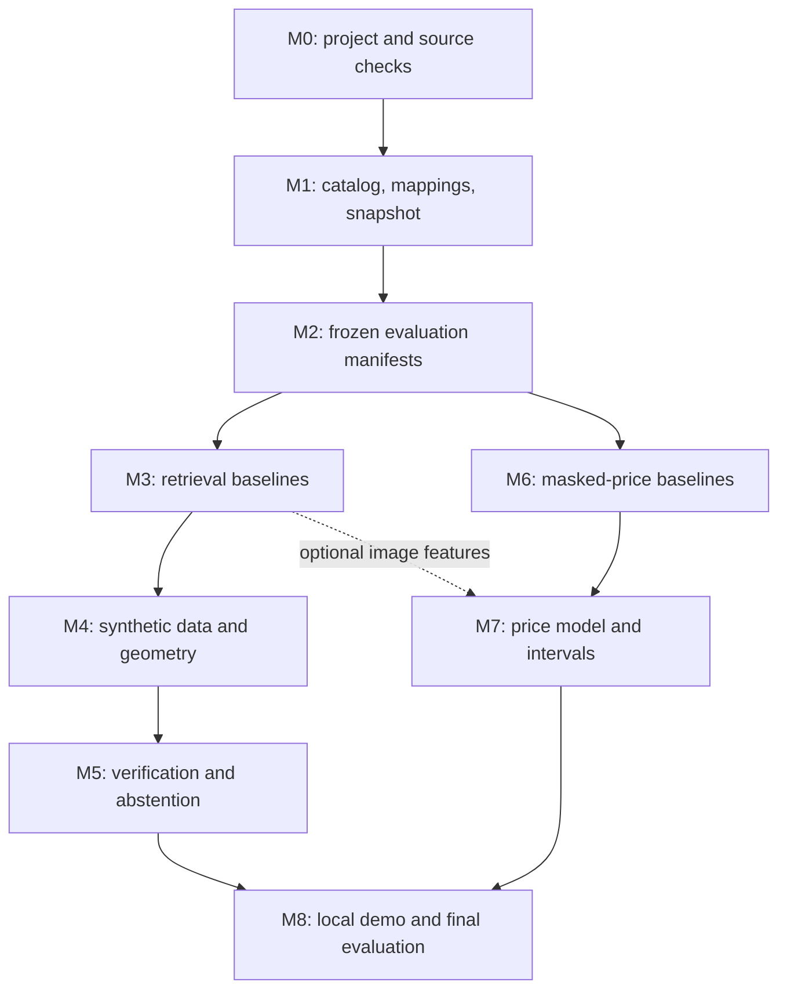

# Learning plan: card identification and reference pricing

Revised on **2026-11-06** after reviewing the original `PLAN.md`, `GUIDE.md`, and `README.md`, checking primary sources, and probing a small sample of live data.

**Verdict:** this is feasible as a learning project using free online data. The useful first version identifies an English Pokémon card from an image and estimates its current reference price when that card's prices are hidden. Evaluating arbitrary phone photos, identifying every printing, and predicting future sale proceeds are separate problems.

This document replaces the earlier plan. [IMPLEMENTATION_PLAN.md](IMPLEMENTATION_PLAN.md) provides the concrete build order, file responsibilities, command interfaces, and acceptance checks. `GUIDE.md` is retained as historical material; its conflicting instructions and numerical claims are not requirements.

## 1. Agreed scope

The user confirmed:

- Use **free sources only**.
- Public images, manual label checks, corner annotations, and synthetic images are acceptable.
- No physical cards, purchases, personal photography, or private data collection are required.
- Start with **current reference-price estimation for cards whose prices are hidden**.

Keep the project small enough to understand each component. Start with a catalog pilot, then expand after the data and evaluation work. A well-explained negative result completes a learning milestone; a prescribed accuracy improvement is not required.

| In the first version | Outside the first version |
| --- | --- |
| English physical Pokémon TCG cards; one selected card crop per query | Other languages, Pocket cards, sealed products, automatic binder scanning |
| Catalog identity: set, collector number, and card record | Reliable foil, stamp, edition, condition, or authenticity recognition from a scan |
| A dated TCGplayer reference price in USD, separately for each mapped printing | A guaranteed sale price, graded premium, net sale proceeds, or near-mint valuation |
| Frozen embeddings, geometry, retrieval, optional evidence from OCR, tabular ML, uncertainty | Mandatory model fine-tuning, paid APIs, deployment infrastructure, forecasting |
| Evaluation on downloaded real scenes and synthetic queries, reported separately | Claims about all phone cameras, households, sleeves, or lighting conditions |

A catalog card ID may correspond to several marketplace products or printings. Identification must not silently select the cheapest or most expensive one.

## 2. What the review changed

| Issue in the earlier documents | Validation or reasoning | Revision |
| --- | --- | --- |
| Buy cards and take hundreds of photos | Conflicts with the agreed online-only scope | Use published real images and annotations; annotate public images where needed |
| Build around a new pokemontcg.io API key | The API documentation says registrations are closed; the bulk repository announces shutdown on March 1, 2027 | Use a pinned bulk catalog for the initial experiment, cache selected images, and avoid a live API dependency. [API notice](https://docs.pokemontcg.io/api-reference/cards/card-object/), [repository notice](https://github.com/PokemonTCG/pokemon-tcg-data) |
| Price history exists only after starting a collector | TCGCSV documents archives from February 8, 2024 | History is an optional later exercise; one frozen snapshot is sufficient for the agreed task. [Archive documentation](https://tcgcsv.com/faq) |
| Roboflow detection labels can train card identity or four corners | The inspected project lists the classes `Pokemon Card` and `PSA`; these are not exact card identities | Inspect the exported annotation format. Boxes do not establish projective corners. [Dataset page](https://universe.roboflow.com/findpokemoncard/find-card) |
| Public real evaluation data is missing | TCG-AR publishes identity annotations and a real-image download | Use it as the first evaluation candidate, subject to the checks below. [Asset documentation](https://github.com/ULiege-VIULab/tcg-ar/blob/main/docs/DATA.md) |
| Evaluate after every milestone on the same test set | Aggregate test results can still influence later choices | Use development data during milestones; run a frozen comparison on test only after choices are locked |
| Same-set median while holding out whole sets | The required same-set labels are unavailable in that experiment | Use masked cards as the primary experiment; define whole-set holdout separately |
| Current-value estimation and release-date forecasting are mixed | They require different targets and information cutoffs | Predict a same-snapshot reference price first |
| Use hidden-card low, high, other printings, or neighbor prices indirectly | These can reveal the supposedly hidden target | Hide all price fields and printings of held-out identities from every model input |
| Treat market prices outside low/high as impossible | Market reflects recent sales; low/mid/high describe a different price summary | Flag suspicious rows for inspection; do not impose this inequality as a cleaning rule. [Market-price explanation](https://help.tcgplayer.com/hc/en-us/articles/213588017-TCGplayer-Market-Price) |
| Treat flat quotes or missing prices as evidence of few sales | The sampled feed has no sale count or individual transactions | Describe observed availability and variability without inferring liquidity |
| Guarantee conformal coverage on new sets | Standard guarantees need assumptions such as exchangeability; related cards and distribution shift complicate them | Measure coverage and interval width; explain the assumptions. [Conformal prediction tutorial](https://arxiv.org/abs/2107.07511) |
| Assume the photo and price imply near-mint condition | The sampled price rows have no condition field | Show the source's aggregate reference price and state that condition is not assessed |
| Require every added model to beat the previous one | Encourages repeated tuning and obscures what was learned | Keep the simpler method when an addition does not help |
| Installation and reproduction commands appear ready | There is no application, dependency file, lockfile, or result artifact in the current repository | Label the proposed layout and interfaces as planned; remove misleading setup instructions |

The old guide also contains detailed throughput, OCR, join-coverage, and price-distribution measurements. Their scripts, manifests, and result files are not present in this repository. This review did **not** reproduce them, so they are not used as established results or performance targets. Rarity and subtype are also distinct metadata fields; for example, an illustration rarity should not be treated as an EX/V-style subtype.

## 3. Data sources and what was actually checked

Checks below are dated **2026-11-06**. Small probes establish accessibility and schema, not full-dataset quality.

| Source | Role | Checked in this review | Remaining check before use |
| --- | --- | --- | --- |
| [Pokémon TCG bulk data](https://github.com/PokemonTCG/pokemon-tcg-data) | Initial English catalog and legacy IDs compatible with TCG-AR | Deprecation notice; `sets/en.json` contained 176 sets; one legacy image endpoint returned PNG data | Pin a commit; count cards; validate selected images and metadata; record source notices |
| [TCGdex](https://tcgdex.dev/) | Free alternative catalog/images and mapping evidence | One card response and its image endpoint worked; the response included marketplace pricing | IDs and numbering differ. Its [FAQ](https://tcgdex.dev/faq) acknowledges incorrect marketplace mappings, so it is supporting evidence, not ground truth |
| [TCGCSV](https://tcgcsv.com/docs) | Product records and current price snapshot | Live update timestamp `2026-11-06T20:05:28+0000`; 221 Pokémon groups; Base Set group 604 had 109 products and 108 price rows, all joining to product IDs | Validate other sets, single-card filtering, printing semantics, and catalog-to-product joins |
| [TCG-AR assets](https://github.com/ULiege-VIULab/tcg-ar/blob/main/docs/DATA.md) | Public real scenes for identification and geometry evaluation | Repository listing contained 51 identity-annotation files. One file contained four coordinate pairs and catalog IDs. The published download returned ZIP bytes after Google's normal large-file confirmation; advertised size was 168,692,834 bytes | Download fully, hash and decode images, check all labels/corners, inspect duplicate scenes and source notices |
| [Roboflow find-card](https://universe.roboflow.com/findpokemoncard/find-card) | Optional additional real-image source | Page labels the dataset CC BY 4.0 and lists two detection classes | Pin an export version and inspect its images, split lineage, and labels; do not reuse the old unverified count of 751 |
| [ambientCG](https://docs.ambientcg.com/license/) | Optional background textures | Provider documents CC0 for its assets | Record asset IDs and hashes; split backgrounds before generating composites |

The [TCG-AR paper](https://arxiv.org/html/2607.02090v1) describes 51 scenes with 832 annotated card instances, including face-down and occluded cards. Those are **author-reported** counts, not this review's measured number of usable identification queries. The scenes are webcam views of game boards, so they do not establish broad phone-photo performance.

No full image archive, full catalog image collection, complete price history, or model was downloaded or benchmarked for this review. The archive start date is documented by the provider; archive completeness was not tested.

### Access and storage

Use source-provided downloads and documented endpoints. Preserve source URLs, revisions, retrieval times, checksums, and applicable notices in a source manifest. A code or database license does not automatically license all depicted card artwork. Keep downloaded images, raw prices, and checkpoints outside Git; publish only artifacts permitted by their sources.

TCGCSV documents daily refreshes, a `last-updated.txt` check, a custom User-Agent, pacing, local caching, and no repeated downloads of immutable archives. Follow its [usage guidelines](https://tcgcsv.com/docs). The demo reads local data. Begin with only the groups needed for the pilot; no full historical backfill is required.

TCG-AR's code repository uses GPL-3.0 and requests citation for use of its code, models, or data. Record the dataset's accompanying notices separately. Use the real-data download without installing its streaming application or copying its entire training stack. Its background-download manifest currently has no default URL; use procedural backgrounds or the verified texture source instead. [Repository](https://github.com/ULiege-VIULab/tcg-ar), [download manifest](https://github.com/ULiege-VIULab/tcg-ar/blob/main/scripts/download_assets.py)

If an image source is unavailable or unsuitable, keep working on pricing and synthetic identification. Label identification results synthetic-only until usable public real data is available; do not substitute personal photography or a paid source.

## 4. Definitions and data contracts

Use one explicit identity vocabulary throughout the code:

- **Card:** a record in a named catalog version, including language, set, and collector number.
- **Printing:** a marketplace-specific variant, retained exactly as the provider describes it until a mapping is verified.
- **Query:** an image or crop to identify; its provenance is independent of its card label.
- **Reference price:** the chosen provider's `marketPrice` for a product and printing in snapshot `t`, in USD.
- **Hidden card:** a card whose price information is unavailable to the pricing model, even if the evaluation harness holds its label.

| Planned artifact | Key fields / rules |
| --- | --- |
| `catalog.parquet` | `catalog_version, card_id, language, set_id, release_date, collector_number, name, supertype, subtypes, rarity, artist, image_url, image_sha256` |
| `crosswalk.parquet` | `catalog_version, card_id, product_id, source_printing, mapping_status, evidence_url, mapping_version`; ambiguous mappings remain unresolved |
| `price_snapshot.parquet` | `snapshot_id, source, source_updated_at, fetched_at, product_id, source_printing, currency, market_price`; preserve other source fields in raw storage |
| `queries.csv` | `query_id, source_url, source_revision, scene_group, card_id, label_status, corners, split, sha256`; explicitly represent unknown/ambiguous labels |
| `synthetic_manifest.parquet` | `query_id, card_id, background_id, generator_version, seed, corners, split` |
| `pricing_split.csv` | `identity_group, card_id, split, snapshot_id`; all linked products and printings stay together |
| `results.csv` | `run_id, git_commit, config_hash, data_version, split, seed, n, metrics, runtime, notes` |

Keep collector numbers as strings, including prefixes and leading zeros. Normalize them only for matching, preserving the originals. Name alone is never a valid price join. Exclude sealed products, lots, and unresolved language/edition variants.

Require each accepted price row to map to exactly one modeled card/printing. Investigate multiple catalog IDs sharing a product ID; if equivalent aliases are retained, group them in every pricing split. Check a manually reviewed sample across eras, promos, prefixes, and look-alikes. Report correctness and unresolved coverage separately; do not force a high match percentage by accepting uncertain joins.

## 5. Evaluation design before modeling

### Identification: known catalog, unseen query images

The primary task searches a frozen gallery containing the correct reference card. Keeping that reference image in the gallery is required, not leakage. Training on or tuning against the held-out query photograph is leakage.

1. Build a small pilot gallery of roughly 1,000 cards, including benchmark identities and deliberate look-alikes. Freeze this candidate list and report its size. Later expand to the validated catalog without mixing the two scores.
2. Separate real queries from synthetic queries. Clean scans transformed by augmentation are synthetic tests, even when their original scans came from the internet.
3. Split real data approximately **40% development / 20% calibration / 40% final test**, by independent scene or capture group. All crops, nearby frames, and edited duplicates from a group stay together. Audit duplicates across sources before splitting.
4. Repeated card identities may occur across different scene groups in this known-catalog task. Report their overlap. An unseen-identity experiment needs a different split, described under extensions.
5. If the scene groups are too few or too connected for three useful partitions, retain the real set as a final external test and develop on synthetic data or a separately annotated public source. Without real calibration data, call the output a similarity score; do not label it a calibrated real-photo probability.
6. Use uncertain identities only for ambiguity/rejection analysis. A box labeled “card” is not an exact identity label, and four box corners are not necessarily the card's corners.
7. Separate ground-truth-corner crops, automatically rectified crops, and raw selected crops. The first is a diagnostic experiment, not an end-to-end result.

Report top-1, recall@5, recall@20, per-card macro accuracy, candidate-gallery size, and counts by look-alike and image-quality slice. Compare models using paired errors on the same queries. Bootstrap by scene group, and check sensitivity to repeated card identities; do not treat every crop as independent or use a plain per-photo significance test when clustering matters.

For rejection, include face-down cards and public negative images where available. Also reserve some card groups outside the gallery to measure rejection of unknown identities. Exclude those groups from synthetic training. A synthetic unknown-card test is a controlled check, not proof of broad rejection of real-world unknowns.

Select models on development data. Fit confidence calibration and choose the acceptance threshold using calibration data after the retrieval pipeline is fixed. Report accuracy among accepted queries, acceptance coverage, and false acceptance of unknowns, with denominators and uncertainty. A cosine score or softmax over neighbors is not automatically a probability.

### Pricing: same-snapshot masked-card experiment

**Question:** given metadata, images, and visible prices of other cards in snapshot `t`, how well can we reconstruct the hidden card's reference price in the same snapshot?

This tests price imputation on otherwise priced cards. It does not directly establish performance on truly unpriced cards, future sets, or future sale prices.

1. Freeze one complete source snapshot and its update timestamp. Save the included groups and extraction failures. If the source refresh changes during ingestion, quarantine the partial run and finish a consistent version.
2. Use mapped single-card printings with positive, finite USD targets. Keep missing, zero, invalid, and ambiguous rows in an exclusion report rather than converting them to zero or silently dropping them.
3. Split approximately **60% fit / 15% development / 10% calibration / 15% final test**, grouped by card identity and any shared product aliases. Balance broad set/rarity strata where group sizes permit.
4. Hide **all price information** for development, calibration, and test identities from feature building: every printing, provider, date, low/mid/high field, aggregate, and price-derived statistic. Their labels are accessible only for their assigned evaluation/calibration role.
5. Use only fit-partition prices for peer medians, Pokémon/artist summaries, and image-neighbor features. For fit rows, build those features out of fold by identity, excluding the row and sibling printings.
6. Catalog metadata and images available at snapshot `t` may be shared across partitions. Unknown categorical values must have a fallback. Exclude target-card ID and marketplace ID as model features.
7. Keep the final fit partition fixed after model selection for the first version. This makes the visibility rules easy to audit; recalibration is required if training data or the model changes.

Primary error is **mean absolute log error**, `mean(abs(log(predicted) - log(actual)))`, with positive predictions. Also report dollar MAE, median absolute percentage error for a declared subset such as prices at least $1, and errors in the bands under $1, $1–5, $5–25, $25–100, and $100+. Define non-overlapping band boundaries in code. Show counts and both row-weighted and card-weighted summaries so cards with more printings do not dominate. Use paired bootstrap intervals grouped by card identity; report variation across sets as a separate sensitivity check.

A secondary experiment may hold out whole sets at the **same snapshot date**. Rebuild every peer statistic under that split and use cross-set fallbacks. This measures transfer across sets today; it is not a historical launch-day backtest.

## 6. Build order and learning milestones

Each milestone records **what I expected, what happened, and what surprised me** in `LEARNING_LOG.md`. Save development predictions as well as metrics. Keep changes small enough to explain why they helped or failed.



### M0. Make the experiment reproducible

**Learn:** provenance, reproducible environments, and small data checks.

**Build:** create a minimal Python package and lock dependencies on the actual machine. Start with an HTTP client, a dataframe/Parquet library, Pillow, NumPy, scikit-learn, and pytest. Add PyTorch/Transformers, OpenCV, LightGBM, OCR, and the demo library only when needed. Use CPU for ingestion and tabular baselines; use available GPU resources for embeddings if helpful.

Add ignore rules for downloaded data, runs, image galleries, and checkpoints before downloads. The current `.gitignore` does not yet cover the planned `data/` directory. Keep split/source manifests outside that ignored tree. No recurring job or cloud service is needed.

**Deliverable:** `pyproject.toml`, a lockfile, source manifest, learning log, and a CPU smoke check.

- [ ] Done when a small install/import check works, artifact paths are excluded from Git, and every proposed source has a recorded access decision. Do not inherit the old guide's package pins or throughput claims without rerunning them.

### M1. Build a trustworthy catalog-to-price pilot

**Learn:** entity resolution, variant identity, and missing-data reporting.

**Build:** pin the bulk catalog; download the pilot images with resume support; inspect image decoding, alpha handling, and wrong scans. Build look-alike candidates from name/artist metadata and image similarity, then check them visually. Name plus artist is a candidate grouping, not proof of shared artwork.

Fetch the needed TCGCSV product and price groups. Map by verified set, number, name, language, and printing evidence; retain conflicting candidates for review. Use TCGdex as optional supporting evidence. Keep source IDs unchanged beside normalized fields.

**Deliverable:** catalog, image manifest, look-alike map, crosswalk, one frozen price snapshot, and a coverage report.

- [ ] Done when every accepted pilot join has an unambiguous interpretation, the reviewed sample and exclusions are recorded, and rerunning ingestion reuses cached inputs. A second identical run must not duplicate rows.

### M2. Freeze public-image and pricing evaluation

**Learn:** leakage, correlated observations, and the difference between available labels and usable labels.

**Build:** download TCG-AR images and inspect their annotations. Validate coordinate bounds against actual image dimensions, corner ordering, identity resolution, and the meaning of extra annotation flags. If useful, manually add identities/corners to suitable Roboflow images. Split scene groups before generating crops.

Create the identification and pricing manifests from section 5. Partition background assets and generator seeds before synthetic generation. Keep final-test outcomes out of development notebooks.

**Deliverable:** versioned manifests, an annotation audit, and metric functions checked against small hand-computed examples.

- [ ] Done when duplicate/group-overlap checks pass, all supervised labels resolve or have explicit exclusion reasons, and a dummy predictor produces a complete metrics row.

### M3. Measure simple retrieval baselines

**Learn:** embeddings, cosine similarity, nearest-neighbor retrieval, and recall ceilings.

**Build:** compare a perceptual-hash baseline with one frozen image encoder, initially [DINOv2](https://huggingface.co/facebook/dinov2-base). Optionally compare [SigLIP 2](https://huggingface.co/google/siglip2-base-patch16-224) once the first pipeline works. Use each model's prescribed preprocessing, preserve useful card borders, normalize embeddings, and use exact search.

Run raw selected crops and ground-truth-corner rectified crops separately. Cache reference embeddings with model revision and preprocessing configuration. Benchmark decoding plus preprocessing plus inference plus search, not just GPU forward passes.

**Deliverable:** development results table and a development-only failure gallery.

- [ ] Done when the baseline is reproducible and its largest failure categories are explained. For scale, 20,000 × 768 float32 embeddings occupy about 61 MiB before overhead, so approximate search is unnecessary initially.

### M4. Add synthetic views and automatic geometry

**Learn:** homography, augmentation, and the synthetic-to-real gap.

**Build:** first generate single-card composites from catalog scans and procedural or downloaded permitted backgrounds. Save the exact quadrilateral and label. Vary perspective, orientation, lighting, blur, scale, JPEG artifacts, and simple glare. Synthetic glare is an approximation of physical foil behavior.

Then implement an OpenCV contour/quad baseline using [perspective correction](https://docs.opencv.org/4.x/d9/dab/tutorial_homography.html). This ordering fixes the earlier dependency in which a learned detector needed a generator that had not been built.

Measure auto-rectification failure rate and corner error normalized by card diagonal, plus downstream identification. Test rotations explicitly. Retain the raw crop when geometry is unreliable; do not silently discard difficult queries.

**Deliverable:** generator, rectifier, and raw/automatic/oracle-corner comparison on development data.

- [ ] Done when the geometry trade-off and retrieval errors by synthetic corruption type are measured. If a learned model is added, separately compare training with and without an augmentation. Add a learned corner detector only if the measured failures justify it.

### M5. Verify candidates and learn when to abstain

**Learn:** retrieval versus reranking, noisy evidence, and selective prediction.

**Build:** try one improvement motivated by M3/M4 failures: local feature matching with geometric verification, or OCR of the name/number/set information. Parse formats such as `4/102`, `TG01/TG30`, and promo numbers. OCR disagreement is evidence weighted by reading quality; missing text is neutral. Collector number alone is not globally unique.

Compare retrieval recall@k with post-verification top-1. A reranker cannot recover a card absent from its candidate set. Fit any learned combination using development data, then freeze it before calibration.

**Deliverable:** stage-by-stage development metrics, calibrated confidence where supported, and an acceptance rule selected without final-test labels.

- [ ] Done when the result can be reported as “at X% acceptance coverage, Y% of accepted identities are correct; Z% of tested unknowns are accepted,” with counts and an honest scope statement.

### M6. Establish price baselines with hidden labels

**Learn:** robust summaries, long-tailed targets, missingness, and feature leakage.

**Build:** audit snapshot values without assuming that `marketPrice` must fall between listing low and high. Keep raw values and quality flags. Treat the snapshot timestamp as feed freshness, not proof that every individual price recently changed.

Implement baselines using visible fit rows only:

1. Global median by printing, falling back to the global median.
2. Same set, rarity, and printing median, with rarity/printing then global fallbacks.
3. Same Pokémon and printing across other cards, with a fallback for Trainers, Energy, and sparse groups.
4. A verified earlier same-art card's price, where available, with the same declared fallback.

Report each baseline on the full eligible development set, not only the easy cases where it has a close match. Record fallback rates.

**Deliverable:** frozen snapshot/splits, cleaning report, baseline predictions, and a leakage check that fails if a hidden identity reaches any price-derived feature.

- [ ] Done when the benchmark can be rerun and the best simple baseline is known. A price lookup is a separate product feature, not a valid masked-price predictor.

### M7. Fit one price model and evaluate ranges

**Learn:** gradient boosting, out-of-fold features, ablations, quantiles, and calibration.

**Build:** fit LightGBM to log price with absolute-error loss. Start with metadata: rarity, printing, supertype/subtypes, set/series, release age at snapshot `t`, artist, Pokémon identity where meaningful, and catalog counts. Keep missing categories explicit. Add price-based summaries only under M6's visibility rules.

Compare against the strongest baseline using fixed development data. Optionally add similarity-weighted prices of visible training neighbors from M3 embeddings; exclude each training card and all sibling printings when constructing its features. Compare metadata only with metadata plus images before considering fine-tuned embeddings.

For an 80% interval, begin with the chosen point predictor and split conformal absolute residuals in log space. Use calibration data only after model selection. Take the finite-sample quantile at rank `ceil((n + 1) * 0.8)`; if this exceeds the available scores, report that a finite interval is unsupported.

For a conservative card-level calibration exercise with multiple printings, use each calibration identity group's **maximum** residual across its modeled printings as its score; `n` above is the number of calibration groups, not price rows. Let `q` be that quantile and form each log-price interval as `[prediction - q, prediction + q]`. This targets simultaneous coverage of those printings under group-level exchangeability. Report both per-row and per-group simultaneous coverage, interval width, and slice counts; do not claim guarantees across shifted sets or related-card dependence.

Exponentiate interval endpoints back to dollars. As a later ablation, compare 10th/50th/90th quantile models and calibrated intervals, handling quantile crossing. [LightGBM objectives](https://lightgbm.readthedocs.io/en/stable/Parameters.html#objective), [calibration reference](https://arxiv.org/abs/2107.07511)

**Deliverable:** baseline/model comparison, feature ablation, calibration specification, and prediction intervals.

- [ ] Done when the extra model's benefit or lack of benefit is explained and interval coverage/width are measured. Keep the baseline if it wins. SHAP is optional and descriptive, not causal evidence.

### M8. Join the parts and report the result

**Learn:** how identification, mapping, and price errors combine.

**Build:** a local Gradio demo that accepts a downloaded image or selected crop:

- Low identification confidence: show candidates and “needs review.”
- Accepted identity with ambiguous printing: list supported printings and ask the user to choose, or display them separately.
- Known mapped price: show the stored reference price, source, currency, and snapshot date.
- Hidden-price demonstration: disable all price access for the query identity and show the model estimate and interval.
- Truly missing price: show a model estimate only if the printing mapping is valid; flag it as outside the measured masked-price population when appropriate.
- Unresolved mapping: show “price unavailable.”

An observed reference quote does not acquire a model confidence interval by attaching the imputation model's interval. Model price intervals assume the identity and selected printing are correct; they do not include all identification error.

Freeze the final configurations before opening the test results. Run the preregistered baseline/final comparisons together, report every planned metric, and make no further selection using that test set. Any later test-informed development needs a new untouched public test partition, or must be labeled exploratory.

Evaluate pricing once with true IDs and once with predicted IDs. For a combined hidden-price result, use the intersection of final identification queries and hidden-price test identities, with prices hidden for all printings of those identities. For dollar-error comparisons, use only queries with verified printing labels or unambiguous single-printing targets; report the excluded fraction and all abstentions. If too few queries qualify, report the two component tests and a qualitative demo without a combined accuracy claim. Reuse a subset of test queries for the demo only after evaluation, clearly marking them as examples rather than new evidence.

**Deliverable:** local demo, saved predictions, final results, failure analysis, and reproduction instructions.

- [ ] Done when a fresh run can reconstruct a headline metric from permitted public inputs and pinned artifacts, or when the report explicitly documents an upstream availability limit. Recomputing a metric from saved predictions is useful but is not the same as rerunning model inference.

## 7. Extensions after the first version

Choose one at a time according to the question you want to learn next.

| Extension | Question | Required change to evaluation |
| --- | --- | --- |
| Fine-tune an embedding on synthetic views | Does metric learning improve real-query recognition? | One loss first; hard negatives from verified look-alikes; no test-query training; compare against the frozen encoder |
| Unseen-card recognition | Can new gallery cards work without encoder retraining? | Hold identities and related art groups out of synthetic training; add their references only for inference; report real and synthetic queries separately |
| Learned corners/detection | Does learning fix failures of contours? | Use synthetic corner labels or verified public polygons; report missed-card rates as well as crop accuracy |
| Same-date whole-set price holdout | Does price imputation transfer to unfamiliar sets? | Hold every price from each test set out of all features; do not use same-set baselines |
| Daily snapshots and free archives | What changes when time is included? | Audit date coverage, timestamps, crosswalk changes, and source freshness before forecasting |
| 14-day forecasting | Can a model beat “no change”? | Chronological splits; complete label windows before each prediction origin; no future information in cleaning or features |
| Release-date pricing | Can launch information predict a later reference price? | Prove historical feature availability and use consistent release-window targets for both training and test; today's catalog is not proof of past availability |
| ANN indexes or collection totals | What changes at larger scale or with correlated errors? | Benchmark against exact search; assess totals on separately defined collections, not by summing marginal interval endpoints |

Paid graded-card data is excluded under the agreed free-only constraint. A real-photo performance limit is a valid finding; future improvements can use more permitted public images without requiring personal card collection.

## 8. Planned repository and checks

This is a proposed layout, not a claim that these files already exist.

```text
card-id-pricing/
  README.md
  PLAN.md
  GUIDE.md                    # historical guide, superseded
  LEARNING_LOG.md
  pyproject.toml
  uv.lock                     # if uv is selected for environment locking
  configs/
  manifests/                  # versioned source/split metadata where permitted
  src/cardid/
    catalog/
    data/
    synth/
    identify/
    pricing/
    evaluate/
    app/
  tests/
  notebooks/
  results/                    # metrics and permitted prediction artifacts
  data/                       # ignored downloaded and derived data
  runs/                       # ignored model artifacts
```

Prioritize checks that catch consequential mistakes: identity/printing joins, missing-value treatment, duplicate split groups, hidden-price contamination, out-of-fold neighbor features, metric denominators, and uncertainty calculations. Use tiny hand-computed cases for metrics and leakage tests. Do not add infrastructure or tests solely to mirror straightforward implementation.

For every experiment, save its configuration, code revision, data/model revisions, split hash, seed, predictions, metrics, and measured compute time. Keep raw output images out of public notebooks. Choose any accuracy or latency target after the first development baseline, before final testing.

**First three work sessions:**

1. Complete M0 and a small M1 sample: a few sets, a few dozen images, and one price snapshot.
2. Finish the mapping audit and M2 splits; confirm usable real queries before expanding image downloads.
3. Produce the M3 identification baseline and M6 price baselines. Use those results to decide the next experiment.

Re-estimate effort after these sessions. The earlier fixed 35-day schedule is not a validated estimate.

## 9. Completion criteria

- [ ] All source data is free and online; no milestone requires physical cards or private photography.
- [ ] Catalog, printing, price target, snapshot date, and data exclusions are explicit.
- [ ] Real-image and synthetic-image results are separated.
- [ ] Hidden-card prices cannot reach model features, including through sibling printings or nearest neighbors.
- [ ] Development, calibration, and final-test roles are respected and recorded.
- [ ] Identification has baseline results, failure analysis, and a measured abstention trade-off.
- [ ] Pricing compares simple baselines with one trained model and reports interval coverage and width.
- [ ] The demo distinguishes observed reference quotes from model estimates.
- [ ] A reader can reproduce a reported metric, and the limits of that reproduction are clear.
- [ ] Every completed milestone has a learning-log entry, including failed hypotheses.

The first version is complete when these learning outcomes are documented. Forecasting, fine-tuning, collection valuation, and hosted serving are optional projects of their own.
