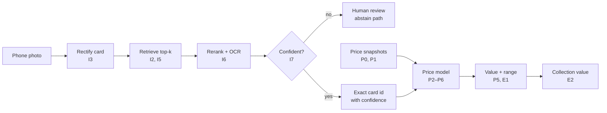

# Project Plan: Card Identification and Pricing

A toy learning project on public Pokémon TCG data. A phone photo goes in; the exact card, a confidence score, and an estimated price with a range come out.

## Goals

The project covers two problems, each with its own set of concepts to learn.

| Part | Problem | Concepts covered |
| --- | --- | --- |
| 1. Identification | Match a photo to the exact card in a catalog of about 20,000, where reprints and variants look nearly identical | Embedding retrieval, card rectification, synthetic data, metric learning, reranking, OCR, calibration, ANN indexes |
| 2. Pricing | Estimate the value of a card, including cards from new sets with no price history | Price data cleaning, baselines, gradient boosting, image-neighbor features, quantile regression, conformal prediction, shrinkage, forecasting |

**How each milestone is written.** *Learn* names the concept to study first. *Build* is the work. *Deliverable* is the artifact in the repo. *Done when* is the check that it worked. Each milestone also gets a short entry in `LEARNING_LOG.md`: what I expected, what happened, what surprised me.

## Datasets

The core data is free. The card catalog and current prices come from pokemontcg.io; real test photos and price history are collected as part of the project.

| Dataset | Used in | What it contains | Limits |
| --- | --- | --- | --- |
| [pokemontcg.io API v2](https://pokemontcg.io) | I0, P0–P7 | Every English card since Base Set: id (`setId-number`), name, set (series, release date), number, rarity, artist, subtypes, small and large images. Prices: TCGplayer low, mid, high, market per printing; Cardmarket average, trend, and 1-, 7-, 30-day averages | Current snapshot only, no history. One image per card id, so normal, holo, and reverse-holo printings share an image. 1,000 requests a day without a key, 20,000 with a free key |
| [PokemonTCG/pokemon-tcg-data](https://github.com/PokemonTCG/pokemon-tcg-data) (GitHub) | I0 | The same card JSON as bulk files, one per set | No prices. Pin a commit so the catalog version is reproducible |
| Own phone photos | I1, every eval | 300+ photos of 150–200 distinct cards in varied conditions, labeled by card id | Collected by hand; not published. Includes deliberate look-alikes (reprints of the same art) |
| [Roboflow "find-card"](https://universe.roboflow.com/findpokemoncard/find-card) | I3 | 751 images for Pokémon card detection, CC BY 4.0 | Inspect annotations before training on it |
| Synthetic composites | I4, I5 | Catalog images warped onto backgrounds with glare, blur, sleeves | Backgrounds from own desk photos or a public texture set such as DTD |
| Daily price snapshots | P0, P7 | One row per card, printing, and day from pokemontcg.io | History starts the day the collector starts |
| [TCG Price Lookup](https://tcgpricelookup.com/tcg-api), paid plan | P8 (optional) | eBay prices, graded values, full price history | Paid. The free tier has TCGplayer prices only |

**Data rules:** only APIs and datasets whose terms allow this use. No scraping of marketplaces or grading services. Card images and artwork belong to their owners and are not committed to this repo.

**One limit to understand early:** TCGplayer "market" is an aggregate the marketplace computes from recent sales, not individual sales. Part 2 therefore models aggregate prices. Individual-sale cleaning is only possible with the optional paid data in P8.

## Part 1: Identification milestones

The order matters: freeze the evaluation set before any model, measure a zero-shot baseline, then add one component at a time and measure what each one buys.

### I0. Catalog and look-alike map

**Learn:** how card identity works: set, collector number, printing. Why reprints and shared art make this a fine-grained problem.

**Build:** download all card JSON and large images into a local catalog. Find look-alike groups: same name and artist across sets, or near-duplicate images by perceptual hash.

**Deliverable:** `catalog.parquet`, local image store, `notebooks/00_catalog.ipynb` with card and set counts, price coverage, and the look-alike groups.

- [ ] Done when the number of cards in look-alike groups is known. These groups become the hard negatives in I5.

### I1. Frozen real evaluation set

**Learn:** why the eval set comes before the model, and how to tag slices.

**Build:** photograph 300+ shots of 150–200 cards. Vary angle, lighting, background, sleeve, and toploader. Include look-alike pairs on purpose. Write a small labeling script that searches the catalog by name and number.

**Deliverable:** `data/eval_real_v1/` with `manifest.csv` (photo, card_id, angle, lighting, sleeve, look-alike flag).

- [ ] Done when every label is checked twice and the set is frozen. Never train on it.

### I2. Zero-shot retrieval baseline

**Learn:** embeddings, cosine similarity, exact (flat) search, recall@k.

**Build:** embed the catalog with two or three off-the-shelf models (for example DINOv2 and SigLIP). Query with the raw photos, no cropping.

**Deliverable:** results table (top-1, recall@5, recall@20, latency per model) and a failure gallery.

- [ ] Done when the top three failure types are named with examples.

### I3. Card detection and rectification

**Learn:** homography, corner detection, why geometric normalization matters for fine-grained matching.

**Build:** first a classical baseline (edges, contours, four-corner quad, warp to the catalog aspect ratio). Then a learned version (a four-keypoint or segmentation model) trained on synthetic composites and the Roboflow set.

**Deliverable:** `rectify.py`, corner-error measurement on 50 hand-labeled photos, and the I2 table rerun on rectified crops.

- [ ] Done when rectification measurably raises top-1 on the real eval set.

### I4. Synthetic training data

**Learn:** domain gap and augmentation design.

**Build:** a generator that warps catalog images onto backgrounds with perspective, glare, blur, sleeve reflections, color shifts, and JPEG artifacts.

**Deliverable:** generator code, a real-vs-synthetic gallery, and one domain-gap check (for example, how easily a classifier separates real from synthetic embeddings).

- [ ] Done when an ablation shows which augmentations matter most.

### I5. Fine-tuned embedding

**Learn:** metric learning (InfoNCE vs. ArcFace), hard-negative mining, batch composition.

**Build:** fine-tune the best I2 backbone (LoRA or last blocks) on synthetic views, mining hard negatives from the I0 look-alike groups.

**Deliverable:** config, training curves, and a table against I2 and I3. Ablations: with and without hard negatives; InfoNCE vs. ArcFace.

- [ ] Done when top-1 rises on the real eval set and the cause of the gain is identified.

### I6. Reranking and verification

**Learn:** bi-encoder vs. cross-encoder; why retriever recall@k caps final accuracy; OCR as a hard constraint.

**Build:** rerank the top-k with local feature matching (keypoints plus RANSAC inlier count) or a small cross-attention reranker. Add OCR of the collector number (for example "4/102") as a check.

**Deliverable:** stage-by-stage metrics: retriever recall@k, top-1 after reranking, top-1 after OCR.

- [ ] Done when the retriever's ceiling is known and the share of the gap each stage recovers is measured.

### I7. Confidence and abstention

**Learn:** calibration, expected calibration error, selective prediction (accuracy vs. coverage).

**Build:** a confidence score from the top-1 vs. top-2 margin and the rerank score, plus a threshold that sends a card to human review.

**Deliverable:** a risk–coverage curve and a chosen operating point.

- [ ] Done when the result can be stated as "at X% coverage, accuracy is Y%."

### I8. Index and serving (stretch)

**Learn:** approximate nearest-neighbor indexes: HNSW vs. IVF-PQ trade-offs.

**Build:** benchmark both against exact search; serve identification behind a FastAPI endpoint.

**Deliverable:** a table of recall@k, memory, and latency per index; a working endpoint.

- [ ] Done when the endpoint returns a card id and confidence for an uploaded photo.

## Part 2: Pricing milestones

P0 starts first, before anything else in either part, because price history only exists from the day the collector starts. The core question is cold-start valuation: can a card from a new set be priced from similar cards?

### P0. Daily price collector

**Learn:** snapshot data vs. transaction data; idempotent, restartable daily jobs.

**Build:** a daily job that pulls TCGplayer and Cardmarket prices for every card and printing into date-partitioned Parquet. Log each run.

**Deliverable:** `prices/date=YYYY-MM-DD/` growing daily, a data dictionary, and a run log.

- [ ] Done when it has run seven days in a row with no gaps and a check that flags missing cards.

### P1. Exploration and cleaning rules

**Learn:** heavy-tailed prices and why to model log price; what market, low, mid, and high each mean; two marketplaces as two noisy measurements of one value.

**Build:** log-price distributions by rarity and era; TCGplayer vs. Cardmarket agreement (one fixed EUR-to-USD rate per day); rules for stale prices (old `updatedAt`), missing values, and implausible values (market above high, jumps that revert next day).

**Deliverable:** `clean_prices.py`, an EDA notebook, and a rules table with the count of rows each rule touches and one example.

- [ ] Done when every rule has a count and an explained example.

### P2. Baselines and the split

**Learn:** why simple baselines come first; error in log space; median absolute percentage error.

**Build:** define the split once: hold out the newest sets entirely, to simulate pricing a new release. Then three baselines: median of same set and rarity; median of the same Pokémon across older sets; price of an earlier reprint with the same art.

**Deliverable:** `splits.py` and a baseline table by price tier.

- [ ] Done when the split is frozen and the baselines are logged.

### P3. Gradient boosting on card features

**Learn:** target-encoding leakage, grouped cross-validation (group by set), reading feature importance with SHAP.

**Build:** LightGBM on log price. Features: rarity, set age, series, subtypes (EX, V, VMAX, ex, illustration rare), printing, artist, Pokémon (target-encoded inside each fold), how many cards exist for that Pokémon.

**Deliverable:** model, error by price tier, SHAP summary.

- [ ] Done when it beats every P2 baseline on the held-out sets under grouped CV.

### P4. Image-neighbor features (the bridge to Part 1)

**Learn:** k-nearest-neighbor regression; when visual similarity predicts value.

**Build:** using the I5 embeddings, add features from the k most similar cards in the training sets: their prices, similarity-weighted.

**Deliverable:** ablation of metadata only vs. metadata plus image features, by rarity tier.

- [ ] Done when it is clear where images help (for example, alternate-art cards) and where they don't.

### P5. Price ranges

**Learn:** quantile regression and pinball loss; split conformal prediction for guaranteed coverage.

**Build:** quantile LightGBM at 10%, 50%, 90%, then conformal calibration on a calibration slice of held-out sets.

**Deliverable:** table of target vs. actual coverage and interval width by price tier.

- [ ] Done when actual coverage is close to the 80% target on the newest sets.

### P6. Noisy and thinly priced cards

**Learn:** hierarchical (empirical Bayes) shrinkage: card toward Pokémon, set, and rarity.

**Build:** flag cards whose snapshot price is missing or swings a lot day to day; shrink their estimates toward group estimates and compare.

**Deliverable:** before-and-after error on the noisy subset.

- [ ] Done when the trade-off between a card's own price and its group's is quantified.

### P7. Short-horizon forecasting (after 6+ weeks of P0 data)

**Learn:** time-based splits with a gap; persistence baselines; why prices often behave like a random walk.

**Build:** predict price 14 days ahead. Compare "no change" against a model with momentum, Cardmarket 7- and 30-day averages, and set age.

**Deliverable:** forecast evaluation table.

- [ ] Done when the result is reported honestly, even if "no change" wins. That is a valid finding.

### P8. Graded premiums (optional, one month of paid data)

**Learn:** grade premium (a top grade vs. raw) and selection bias: only promising cards get graded.

**Build:** with one month of paid price data, model the top-grade to raw price ratio from card features; clean individual eBay sales if the plan includes them.

**Deliverable:** grade-premium analysis with a written note on the bias.

- [ ] Done when it is clear why a naive premium overstates what grading adds.

## Integration milestones

The two parts meet in one demo: a photo goes in, and an exact card, a confidence, and a value with a range come out.



Identification runs left to right across the top; only confident matches reach the price model, which is trained on the daily snapshots.

### E1. End-to-end demo

**Learn:** how errors compound across stages, and how to show uncertainty to a user.

**Build:** a small Gradio or FastAPI page. Low-confidence results show the top three candidates and "needs review" instead of a price.

**Deliverable:** the demo and a two-minute screen recording.

- [ ] Done when it runs on 20 new photos that are in no eval set, with the accuracy recorded honestly.

### E2. Collection value

**Learn:** why card errors are correlated through the market, so a collection's range does not shrink the way independent errors would.

**Build:** photograph a binder page of 9 cards; output each card's estimate and a total with a range, using a simulation with a shared market factor.

**Deliverable:** totals for simulated collections drawn from held-out sets, with a note comparing the naive and correlated ranges.

- [ ] Done when the collection ranges reach their target coverage on held-out sets.

### E3. Technical report

**Build:** a README written as a short report: problem, data, evaluation design, results tables per milestone, failure analysis, and what would change at a much larger scale.

- [ ] Done when someone new can reproduce one headline number from the README alone.

### E4. Adversarial review

**Build:** hand the report and `results.csv` to a reviewer asked only to find leakage, weak baselines, and overclaims. Fix what they find.

- [ ] Done when every challenge has a written answer or a fix.

## Repo layout

```
card-id-pricing/
  README.md            # overview and results
  PLAN.md              # this file
  LEARNING_LOG.md      # one entry per milestone
  data/                # gitignored; catalog, photos, prices
    eval_real_v1/      # frozen, never trained on
  src/
    catalog/           # I0 download and look-alike groups
    rectify/           # I3
    synth/             # I4
    embed/             # I2, I5 training and indexing
    rerank/            # I6 matching and OCR
    prices/            # P0 collector, P1 cleaning
    pricing/           # P2–P8 models
    app/               # E1 demo
  notebooks/           # one per milestone, numbered
  results/results.csv  # every experiment, one row each
```

## Ground rules

1. Evaluation sets are frozen and versioned. A change means a new version (`eval_real_v2`), never an edit.
2. Every experiment adds one row to `results.csv`: date, git hash, milestone, config, metrics.
3. Change one thing at a time. Each table compares against the previous milestone's best.
4. Write the learning-log entry before starting the next milestone: expected, actual, surprise.
5. Keep card images out of the repo. Store card ids and URLs; the artwork belongs to its owners.
6. Use only APIs and data whose terms allow this use. No scraping of marketplaces or grading services.

## References

- [pokemontcg.io](https://pokemontcg.io): card data and prices
- [PokemonTCG/pokemon-tcg-data](https://github.com/PokemonTCG/pokemon-tcg-data): bulk card JSON
- [Roboflow find-card dataset](https://universe.roboflow.com/findpokemoncard/find-card)
- [TCG Price Lookup API](https://tcgpricelookup.com/tcg-api)
