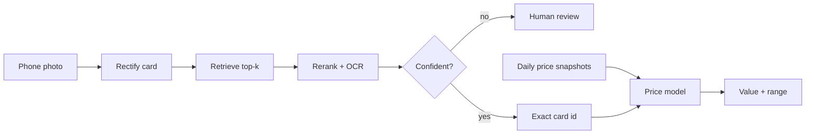

# card-id-pricing

Identify a trading card from a phone photo, then estimate its value with a range.

A toy learning project on public Pokémon TCG data. It covers two problems: fine-grained visual identification against a catalog of about 20,000 cards, and cold-start price estimation for cards with little or no price history. It is not a production system.

## Status

Work in progress. The full plan is in [`PLAN.md`](PLAN.md). Milestones are checked off below as they finish, and every result is logged in [`results/results.csv`](results/results.csv).

## How it works



1. **Rectify:** find the card in the photo and warp it to a flat, front-facing view.
2. **Retrieve:** embed the card and search the catalog for the closest matches.
3. **Rerank and verify:** rescore the top candidates and check the collector number with OCR.
4. **Abstain:** if confidence is low, return the top candidates for human review instead of guessing.
5. **Price:** estimate value from card features and visually similar cards, with an 80% range.

## Results

Filled in as milestones finish. All identification numbers are on a frozen set of real phone photos that is never used for training.

| Milestone | Metric | Result |
| --- | --- | --- |
| I2 Zero-shot retrieval | Top-1 / recall@20 | — |
| I3 + Rectification | Top-1 | — |
| I5 + Fine-tuned embedding | Top-1 | — |
| I6 + Rerank and OCR | Top-1 | — |
| I7 Abstention | Accuracy at 90% coverage | — |
| P3 Price model, new sets | Median absolute % error | — |
| P5 Price ranges | Coverage of 80% interval | — |

## Milestones

**Identification**
- [ ] I0 Catalog and look-alike map
- [ ] I1 Frozen real evaluation set
- [ ] I2 Zero-shot retrieval baseline
- [ ] I3 Card detection and rectification
- [ ] I4 Synthetic training data
- [ ] I5 Fine-tuned embedding
- [ ] I6 Reranking and verification
- [ ] I7 Confidence and abstention
- [ ] I8 Index and serving (stretch)

**Pricing**
- [ ] P0 Daily price collector
- [ ] P1 Exploration and cleaning rules
- [ ] P2 Baselines and the split
- [ ] P3 Gradient boosting on card features
- [ ] P4 Image-neighbor features
- [ ] P5 Price ranges
- [ ] P6 Noisy and thinly priced cards
- [ ] P7 Short-horizon forecasting
- [ ] P8 Graded premiums (optional)

**Integration**
- [ ] E1 End-to-end demo
- [ ] E2 Collection value
- [ ] E3 Technical report
- [ ] E4 Adversarial review

## Data

| Source | Used for |
| --- | --- |
| [pokemontcg.io](https://pokemontcg.io) API v2 | Card catalog, images, TCGplayer and Cardmarket prices |
| Own phone photos | Real evaluation set (not published) |
| Synthetic composites | Training views for the embedding model |
| Daily price snapshots | Price history, collected by `src/prices/` |

Card images and artwork belong to their owners and are not stored in this repo. The code stores card ids and image URLs only. Only APIs and datasets whose terms allow this use are used; nothing is scraped from marketplaces or grading services.

Pokémon and all related names are trademarks of their respective owners. This project is not affiliated with or endorsed by them.

## Repo layout

```
card-id-pricing/
  README.md
  PLAN.md              # milestones, datasets, ground rules
  LEARNING_LOG.md      # what I expected, what happened, what surprised me
  data/                # gitignored; catalog, photos, prices
  src/
    catalog/           # download catalog, find look-alike groups
    rectify/           # card detection and perspective correction
    synth/             # synthetic training views
    embed/             # embedding models, training, indexing
    rerank/            # reranking and OCR checks
    prices/            # daily collector and cleaning
    pricing/           # price models
    app/               # demo
  notebooks/           # one per milestone, numbered
  results/results.csv  # one row per experiment
```

## Setup

```bash
git clone https://github.com/<you>/card-id-pricing.git
cd card-id-pricing
python -m venv .venv && source .venv/bin/activate
pip install -r requirements.txt
export POKEMONTCG_IO_API_KEY=<your free key from dev.pokemontcg.io>
```

## Ground rules

1. Evaluation sets are frozen and versioned; a change means a new version, never an edit.
2. Every experiment adds one row to `results/results.csv` with the git hash and config.
3. One change at a time, compared against the previous best.
